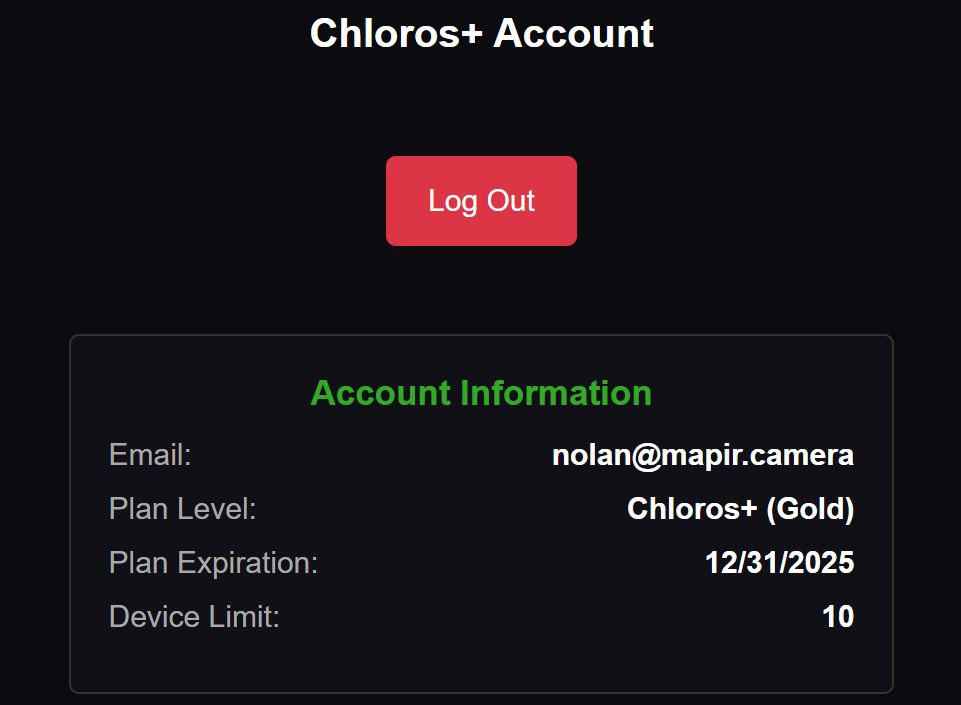

# Pieslēgšanās Chloros+

## Pieslēgšanās ar grafisko lietotāja saskarni (GUI)

Lietotāja  sānu joslas izvēlne ļauj jums pieslēgties savam Chloros+ kontam un atbloķēt papildu funkcijas.

**Katram datoram ir nepieciešams pieslēgties tikai vienu reizi.** GUI, CLI un Python SDK izmanto vienu un to pašu kešēto sesiju — pieteikšanās caur darbvirsmas GUI aktivizē arī CLI un SDK šajā datorā (un otrādi, izmantojot `chloros-cli login`).

Pēc pieteikšanās tiks parādīta jūsu konta informācija:

<figure><figcaption></figcaption></figure>
<!-- SCREENSHOT-UPDATE: re-shoot the logged-in user account panel in Chloros 1.3.0 — plan name display and the registered-device list UI may have changed; must show plan name, expiration, and device list. -->

## Pakalpojumu līmeņi

| Pakalpojums | `plan_id` | Tips |
| --- | --- | --- |
| Iron | `0` | Bezmaksas |
| Copper | `1` | Maksas (Chloros+) |
| Bronze | `2` | Maksas (Chloros+) |
| Silver | `3` | Maksas (Chloros+) |
| Zelts | `4` | Maksas (Chloros+) |

Lai uzzinātu, ko ietver katrs maksas līmenis, skatiet [plānus un cenas](https://cloud.mapir.camera/pricing).

### Lai piekļūtu CLI/SDK, ir nepieciešams maksas līmenis

CLI un Python SDK piekļuvei ir nepieciešams **jebkurš maksas Chloros+ līmenis (Copper vai augstāks)**. Tas tiek nodrošināts**servera pusē** — katram CLI/SDK pieprasījumam ir jābūt gan aktīvai sesijai, gan maksas plānam:

| HTTP statuss | `error_code` | Nozīme | Risinājums |
| --- | --- | --- | --- |
| `401` | `AUTH_REQUIRED` | Nav pieteicies šajā ierīcē | `chloros-cli login <email> <password>` |
| `403` | `PLAN_UPGRADE_REQUIRED` | Esat pieteicies, bet plāna līmenis ir pārāk zems (bezmaksas „Iron” līmenis) | Pārejiet uz jebkuru maksas „Chloros+” plānu |

`chloros-cli status` joprojām ir pieejams bezmaksas līmenī, tādēļ jūs vienmēr varat redzēt savu pašreizējo plānu un iemeslu, kāpēc piekļuve ir atteikta.

### Pieslēgtās aparatūras ierobežojumi katram plānam

Katram plānam ir noteikts maksimālais skaits LATTICE kameru un DAQ gaismas sensoru, kurus vienlaikus var pieslēgt tiešraidē:

| Pakete | LATTICE kameras | DAQ gaismas sensori |
| --- | --- | --- |
| „Iron“ (bezmaksas / nav pieteicies) | 4 | 2 |
| „Copper“ / „Bronze“ | 6 | 3 |
| „Silver“ | 10 | 6 |
| Gold | 20 | 12 |

## Pieslēgšanās ar CLI


Piesakieties ar savām Chloros+ piekļuves datiem, lai aktivizētu CLI apstrādi. Linuxā (bez grafiskās saskarnes) tas ir vienīgais veids, kā aktivizēt savu licenci.

**Sintakse:**

```bash
chloros-cli login <email> <password>
```


**SDK lietotāji**: Python SDK piedāvā arī programmatisku metodi `logout()`, lai dzēstu kešatmiņā saglabātās piekļuves datus. Sīkāku informāciju skatiet [SDK atsauces materiālā](reference/sdk-reference.md).


**Piemērs:**

```powershell
chloros-cli login user@example.com 'MyP@ssw0rd123'
```


**Īpašie simboli**: Parolēm, kurās ir simboli, piemēram, `$`, `!` vai atstarpes, izmantojiet vienkāršās pēdiņas.


**Izvade:**

<figure><figcaption></figcaption></figure>
<!-- SCREENSHOT-UPDATE: re-shoot the CLI login output — the banner now prints "Chloros CLI 1.3.0"; capture a successful login with the current output format. -->

### Piekļuves datu uzglabāšana

Cache atmiņā saglabātie piekļuves dati un konfigurācija **visās platformās** tiek uzglabāti jūsu lietotāja mājas direktorijā esošajā `.chloros` mapē:

| Platforma | Pieslēgšanās datu kešatmiņas ceļš |
| --- | --- |
| **Windows** | `%USERPROFILE%\.chloros\` |
| **Linux** | `~/.chloros/` |

Ja uzstādat jaunāku versiju virs esošās, jūsu pieteikšanās dati tiek saglabāti gan Windows (uzstādīšanas programmā), gan Linux (mapē `.deb`, ieskaitot `chloros-cli update`). Chloros atinstalēšana — vai Linux pakotnes noņemšana — dzēš kešēto pieteikšanos, tādēļ pēc jaunas instalācijas jums būs jāpiesakās no jauna.

### Plāna derīguma termiņš un bezsaistes papildlaiks

Plāna derīguma termiņš lietotāja saskarnē parāda, kad jūsu licence vairs nebūs derīga. Atkārtotajiem ikmēneša abonementiem derīguma termiņš beidzas mēneša beigās; gada abonementiem — gadu pēc abonementa sākuma.

Chloros pārbauda jūsu licenci tiešsaistē, taču darbs bezsaistē tiek atbalstīts pārejas perioda laikā:

* Veiksmīgas servera pārbaudes tiek saglabātas kešatmiņā **5 minūtes**, tādēļ normālas lietošanas gadījumā tiek veikti ļoti nedaudzi licences pieprasījumi.
* Parakstīta, ar konkrētu datoru saistīta licences kešatmiņa nodrošina ilgākus bezsaistes darbības periodus: **30 dienas ikmēneša plāniem**un**līdz jūsu abonementa derīguma termiņa beigām (ne vairāk kā 365 dienas) gada plāniem**.
* Kad pārejas periods beidzas, plāns pāriet uz bezmaksas „Iron” līmeni, līdz ierīce vismaz reizi var sazināties ar licences serveri; piekļuve tiek atjaunota pēc nākamās veiksmīgās pārbaudes.

### Ierīču skaita ierobežojums

Katrs „Chloros+“ plāns piedāvā atšķirīgu reģistrēto ierīču skaitu. Katra ierīce, kurā jūs piesakāties ar „Chloros+“ kontu, tiek ieskaitīta jūsu reģistrēto ierīču skaitā. Jūs varat pārdēvēt un dzēst ierīci savā „MAPIR Cloud“ konta lapā.

<table><thead><tr><th width="168.5999755859375" align="right">Chloros+ plāns</th><th align="center">COPPER</th><th align="center">BRONZE</th><th align="center">SILVER</th><th align="center">GOLD</th></tr></thead><tbody><tr><td align="right">Atbalstītās ierīces</td><td align="center">2</td><td align="center">2</td><td align="center">5</td><td align="center">10</td></tr></tbody></table>

Jūsu konta precīzais ierīču limits ir norādīts jūsu MAPIR Cloud konta lapā. Izietot no ierīces, tās vieta tiek droši atbrīvota, un jau reģistrēta ierīce vienmēr var atkal pieslēgties, pat ja kontam ir sasniegts ierīču limits.
